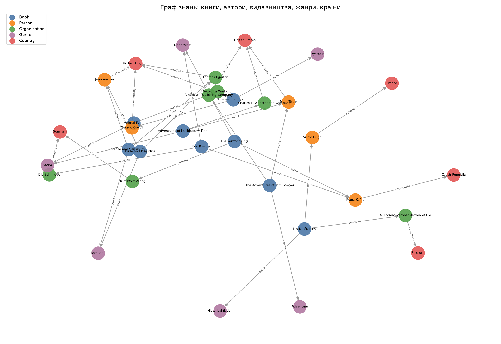

# Лабораторна робота №01. Технології Semantic Web: RDF та SPARQL

## 1. Опис предметної області та джерела даних

Предметна область: книги. Граф описує дев'ять книг, їх авторів (п'ять осіб), видавництва (сім), жанри (шість) і країни (шість). Набір даних створено вручну в файлі `data.py` на основі загальновідомих фактів про перші видання книг: рік видання, видавництво, країна видавця і національність автора. Зовнішні набори даних не використовувалися, тому окремого джерела для цитування немає. Російські джерела і російські твори в наборі не використано. Для зв'язку з Wikidata (п. 5) використано ідентифікатори (QID) сутностей Wikidata.

## 2. Структура RDF-графу та його візуалізація

Граф містить 161 трійку і такі сутності:

| Тип сутності | Клас | Кількість |
|---|---|---|
| Книга | `schema:Book` | 9 |
| Автор | `schema:Person` (+ `foaf:Person`) | 5 |
| Видавництво | `schema:Organization` | 7 |
| Жанр | `ont:Genre` (власний клас) | 6 |
| Країна | `schema:Country` | 6 |

Разом 33 екземпляри у 5 типах. Типи зв'язків (властивості, що вказують на інший ресурс): `schema:author`, `schema:genre`, `schema:publisher`, `schema:nationality`, `schema:location` і `owl:sameAs`. Літеральні властивості: `schema:name`, `schema:datePublished`, `schema:birthDate`, `schema:inLanguage`, `rdfs:label`, `foaf:name`.

Використані словники: schema.org, FOAF, OWL, RDFS. Власні URI мають вигляд `http://library.example.org/resource/book-1984`, а власний клас має простір `http://library.example.org/ontology#`.

Візуалізація: файл `graph.png`. Вузли мають колір за типом, стрілки позначають зв'язки. Граф побудовано за допомогою `networkx` і `matplotlib`.



## 3. Приклади RDF-трійок і Turtle

Фрагмент `books.ttl` для книги «Nineteen Eighty-Four»:

```turtle
ex:book-1984 a schema:Book ;
    schema:author ex:person-george-orwell ;
    schema:datePublished 1949 ;
    schema:genre ex:genre-dystopia ;
    schema:inLanguage "en" ;
    schema:name "Nineteen Eighty-Four"@en ;
    schema:publisher ex:publisher-secker-warburg .
```

Та сама трійка у форматі N-Triples (файл `books.nt`):

```
<http://library.example.org/resource/book-1984> <https://schema.org/author> <http://library.example.org/resource/person-george-orwell> .
```

Трійки, пов'язані з `ex:book-1984`, виводяться в консоль. Усі 161 трійку записано у файл `triples_all.txt`.

Серіалізації: Turtle (`books.ttl`) і RDF/XML (`books.rdf`), а також N-Triples (`books.nt`). Turtle є основним форматом, RDF/XML є «ще одним RDF-форматом», як вимагає завдання.

**Ручна зміна Turtle-файлу.** Скрипт, запущений без `--rebuild`, читає `books.ttl` як є, тож ручні правки зберігаються. Щоб продемонструвати це, додайте вручну в кінець `books.ttl` новий блок трійок, запустіть `python main.py` і переконайтеся, що зміна з'явилася в `books.nt` і `results.txt`. Для повернення до початкового стану запустіть `python main.py --rebuild`.

## 4. SPARQL-запити та результати їх виконання

Повний текст запитів міститься у файлі `queries.py`, результати наведено у `results.txt`.

**Q1. Які книги написав Джордж Орвелл? (сортування за роком)**
```
Animal Farm | 1945
Nineteen Eighty-Four | 1949
```

**Q2. Скільки книг у графі має кожен автор? (COUNT)**
```
Franz Kafka | 2
George Orwell | 2
Jane Austen | 2
Mark Twain | 2
Victor Hugo | 1
```

**Q3. Які книги видані у Німеччині? (3 зв'язки: книга → видавництво → країна → назва)**
```
Der Process | Die Schmiede
Die Verwandlung | Kurt Wolff Verlag
```

**Q4. Які книги видані після 1900 року? (FILTER, сортування за спаданням)**
```
Nineteen Eighty-Four | 1949
Animal Farm | 1945
Der Process | 1925
Die Verwandlung | 1915
```

**Q5. Перший, останній і середній рік видання для кожного жанру (MIN, MAX, AVG)**
```
Romance | 2 книги | 1811 | 1813 | 1812
Historical fiction | 1 | 1862 | 1862 | 1862
Adventure | 1 | 1876 | 1876 | 1876
Satire | 2 | 1884 | 1945 | 1914.5
Modernism | 2 | 1915 | 1925 | 1920
Dystopia | 1 | 1949 | 1949 | 1949
```

**Q6. Книги, написані авторами з Франції (зв'язок між типами: книга → автор → країна)**
```
Les Misérables | Victor Hugo
```

**Q7. Федеративний запит до Wikidata** (див. п. 5). Запит бере авторів з нашого графу, через owl:sameAs знаходить їх у Wikidata і через SERVICE отримує український підпис і дату народження. Результат виконання:

```text
authorName         | wd                                         | wdLabel              | wdBirth
Franz Kafka       | http://www.wikidata.org/entity/Q905        | Франц Кафка          | 1883-07-03
George Orwell     | http://www.wikidata.org/entity/Q3335       | Джордж Орвелл        | 1903-06-25
Jane Austen       | http://www.wikidata.org/entity/Q36322      | Джейн Остін          | 1775-12-16
Mark Twain        | http://www.wikidata.org/entity/Q7245       | Марк Твен            | 1835-11-30
Victor Hugo       | http://www.wikidata.org/entity/Q535        | Віктор Гюґо          | 1802-02-26
```
Сполучення з Wikidata працює: для кожного з п'яти авторів знайдено український підпис і дату народження. Федеративний запит виконано на комп'ютері з інтернетом.

Мета запитів: FILTER (Q3, Q4, Q6), сортування (Q1, Q4, Q5), агрегатні функції COUNT, MIN, MAX, AVG (Q2, Q5), перехід через 3 зв'язки (Q3), запит між різними типами сутностей (Q6).

## 5. Зв'язок із Wikidata

Обрано Wikidata. Кожен автор і кожна країна має зв'язок `owl:sameAs` із відповідним ресурсом Wikidata. Приклад:

- Власний ресурс: `http://library.example.org/resource/person-george-orwell`
- Ресурс Wikidata: `http://www.wikidata.org/entity/Q3335` (George Orwell)

Вибір предиката обґрунтовано так. `owl:sameAs` означає, що два URI позначають одну й ту саму реальну сутність. Це саме той сенс, який потрібен тут. На відміну від `rdfs:seeAlso` (лише посилання) або `schema:sameAs` (слабша семантика), `owl:sameAs` дозволяє переносити факти між графами.

Федеративний запит (Q7) бере з власного графу ім'я автора та його `owl:sameAs`-посилання, а з Wikidata через `SERVICE` отримує українську мітку (`rdfs:label`) і дату народження (`wdt:P569`). Так один запит використовує дані обох графів.

**Застереження щодо QID.** Ідентифікатори Q3335, Q36322, Q905, Q7245, Q535, Q30, Q142, Q31, Q145, Q183 і Q213 перевірено через API Wikidata: назва і опис кожного QID відповідають потрібній сутності. Спочатку для Франца Кафки було вказано Q5879, але це Йоганн Вольфганг фон Гете. Після перевірки виправлено на Q905 (Franz Kafka, Bohemian writer from Prague).

## 6. Помилковий та виправлений приклад

Помилковий запит: порівняння числового року зі строковим літералом.

```
FILTER(?year > "1900")
```

Результат: 0 рядків, без повідомлення про помилку. Причина: `schema:datePublished` зберігає рік як `xsd:integer`, а `"1900"` є рядком (`xsd:string`). Порівняння числа з рядком у SPARQL дає помилку типу, яку фільтр тихо перетворює на «false», тому всі рядки відкидаються.

Виправлений запит: `FILTER(?year > 1900)`. Результат: 4 книги (1915–1949), як і очікувалося. Обидва варіанти виконуються в `run_queries.py` і виводяться у `results.txt`.

## 7. Висновки

Граф зі 161 трійки побудовано з використанням власних URI та словників schema.org, FOAF і OWL. Набір даних складається з англомовних, французьких і німецьких видань. Запити SPARQL охоплюють фільтрацію, сортування, агрегації, багатокрокові переходи і зв'язки між типами сутностей. Зв'язок із Wikidata реалізовано через `owl:sameAs` і федеративний запит. Цей запит потребує інтернету, тож його результат слід отримати та зафіксувати на власному комп'ютері. Типова помилка типів у FILTER наочно показує, наскільки важливо узгоджувати типи літералів у даних і запитах.

## 8. Як запускати програму

Крок 1. Встановіть Python 3.10 або новіший.

Крок 2. Відкрийте папку лаб1 у провіднику і в адресному рядку напишіть cmd, щоб відкрився термінал у цій папці.

Крок 3. Встановіть бібліотеки командою pip install -r requirements.txt. Файл requirements.txt лежить у папці лаб1.

Крок 4. Запустіть програму командою python main.py. Програма створить граф і всі результати в підпапці output.

Крок 5. У консолі з'являться статистика графу, трійки книги 1984 і результати запитів Q1–Q7.

Крок 6. Відкрийте output\graph.png (картинка графу) і output\results.txt (відповіді всіх запитів).

Крок 7. Щоб додати трійку вручну, відредагуйте output\books.ttl, допишіть трійку в кінці файлу і знову запустіть python main.py. Щоб створити граф заново з data.py, запустіть python main.py --rebuild (ручні правки при цьому зітруться).

Крок 8. Для виконання Q7 (зв'язок із Wikidata) запустіть програму на комп'ютері з підключенням до інтернету. Без інтернету Q7 видасть повідомлення про помилку, а решта програми працює. Якщо Q7 не працює через SERVICE, виконайте той самий запит на сайті query.wikidata.org і вставте результат у цей звіт.
